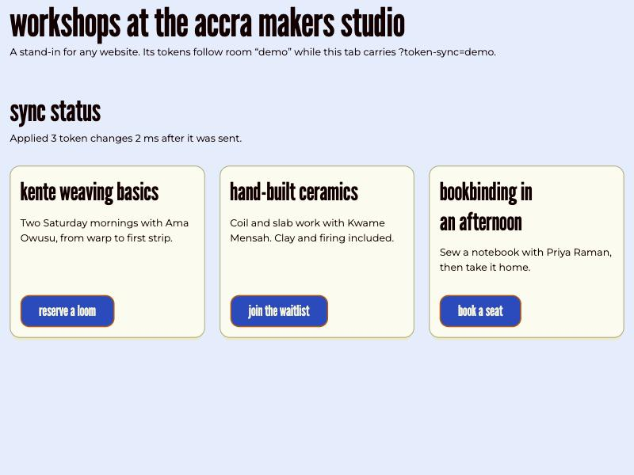

# Token Sync

Change design token values and watch any website update in real time. A Brad Frost Web lab.

```
Source ──▶ Room ──▶ Applier
```

A **source** (a control panel, a CLI watching your token files, Eddie's theme customizer) sends token changes to a **room**. Every **applier** in the room (a page with the drop-in script, a bookmarklet, the extension) sets those values as CSS custom properties on the open page. It works with any design system that uses custom properties. Eddie's theme contract is an optional adapter that adds typed, contrast-safe controls.

**Preview only.** An applier changes the custom properties of the tab it runs in, and nothing else. Real visitors never join a room, so nothing changes in production.



## Try it

```bash
npm install
npm start
```

1. Open <http://127.0.0.1:4321/>, the source page.
2. Select **Open the target page**. It opens with `?token-sync=demo`.
3. Change a colour or the corner radius on the source. The target follows within milliseconds, with no network: both tabs talk over `BroadcastChannel`.

The demo pages load Eddie from unpkg, so they need a network connection to render. Syncing itself doesn't.

## Add it to a page

```html
<script type="module" src="/path/to/packages/script/src/token-sync.js"></script>
```

The script does nothing on an ordinary page view. Visit the page with `?token-sync=<room>` and that tab joins the room, then stays in it for the rest of the tab's session as you click around. `?token-sync=off` leaves.

## The protocol: `token-sync/1`

One JSON message per change, defined in `FEATURE-SPEC.md` §6 on [eddie-design-system#2447](https://github.com/Brad-Frost-Web/eddie-design-system/pull/2447):

```js
{ v: 1, room: 'detach', op: 'set', props: { '--ed-theme-border-radius-md': '1rem' }, scope: '*', from: 'controller', ts: 1760700000000 }
```

| Field | Meaning |
|---|---|
| `op` | `set`, `reset`, `lock`, `unlock` or `snapshot` (catch up a late joiner). Only a presenter may `reset`, `lock` or `unlock`. |
| `props` | Custom property names, or `contract:<path>` keys for Eddie contract knobs |
| `from` | A role: `controller`, `presenter` or `source`. Never an identity. |
| `ts` | Stamped by the channel (the relay, or the local channel), never the sender. Each key keeps its last write by `ts`. |

### Guardrails

- **Values are checked before they land.** Refused anywhere in a value: `url(`, `;`, `{`, `}`, `!important`, backslashes (a CSS escape can spell `url(` without the letters), `<`, `>`, `@`, and anything outside printable ASCII. Only colour functions, `calc`/`clamp`/`min`/`max` and `var()` may appear, so nothing that fetches can get in. Then each value must parse as the kind of value the property already holds on the page: a colour stays a colour, a length stays a length.
- **`setProperty` only.** Values are never joined into CSS text, so a value can't become a rule.
- **Damping.** A page changes at most 3 times a second, whatever arrives (WCAG 2.3.1). The first change lands immediately. Changes arriving faster than that are combined, and the latest one lands at the end of each 333 ms window. So a lone edit lands in a few milliseconds, and an edit inside a burst can wait up to a third of a second.
- **Reset and lock.** A presenter can put every page back to its theme, or make controllers read-only. Over `broadcast` every tab is a presenter. Over the relay, the relay issues a presenter key ([#2](https://github.com/Brad-Frost-Web/token-sync/issues/2)).
- **Last write wins per token**, ordered by the channel's timestamps. Ties resolve the same way on every peer, so every tab ends up showing the same state.

### Raw overrides only move the token you send

In Eddie's `bfw` build, component tokens hold literal values rather than `var()` references. Overriding `--ed-theme-color-background-brand` doesn't recolour a primary button, because the button reads `--ed-theme-button-primary-color-background-default`. That's why the demo's colour control sends the button token directly. Expanding one knob into every token derived from it, with contrast kept legible, is the Eddie contract adapter's job ([#9](https://github.com/Brad-Frost-Web/token-sync/issues/9)).

## Packages

| Package | Job | Status |
|---|---|---|
| `protocol` | `token-sync/1` validation, value checks, per-key last-write-wins | Built |
| `client` | Transports (`local`, `broadcast`) and the applier | Built. `remote` arrives with the relay. |
| `script` | The `?token-sync=<room>` drop-in | Built |
| `relay` | Cloudflare Durable Object per room, and a self-hostable Node relay | [#2](https://github.com/Brad-Frost-Web/token-sync/issues/2) |
| `bookmarklet` | One-click applier for any page | [#3](https://github.com/Brad-Frost-Web/token-sync/issues/3) |
| `extension` | MV3 applier, Chromium and Firefox | [#4](https://github.com/Brad-Frost-Web/token-sync/issues/4) |
| `cli` | `token-sync watch` and `token-sync poll` | [#5](https://github.com/Brad-Frost-Web/token-sync/issues/5), [#6](https://github.com/Brad-Frost-Web/token-sync/issues/6) |
| `remote` | The phone remote | [#8](https://github.com/Brad-Frost-Web/token-sync/issues/8) |

Also planned: the before/after wipe ([#7](https://github.com/Brad-Frost-Web/token-sync/issues/7)) and Google Fonts sync ([#10](https://github.com/Brad-Frost-Web/token-sync/issues/10)).

The packages are plain ES modules with no runtime dependencies and no build step. They import each other by relative path, so a browser can load them straight from disk. A bundler joins when the bookmarklet needs a single file ([#3](https://github.com/Brad-Frost-Web/token-sync/issues/3)).

## Tests

```bash
npm test
```

Node's built-in test runner. The suites cover the value refusals, message validation, last-write-wins ordering and convergence, snapshots for late joiners, damping (with fake timers), and the broadcast transport over a real `BroadcastChannel`.

## Deviations from the BFW defaults

Documented per AGENTS.md §1.6:

- **Vanilla JS with no framework, no build and no Eddie runtime dependency** in the packages. They run inside other people's pages, so they carry nothing those pages didn't ask for. The lab's own UI (the demo pages here, and later the remote and the extension popup) is built from Eddie.
- **Google Fonts.** AGENTS.md §2.2 forbids Google Fonts links. The applier's planned font sync ([#10](https://github.com/Brad-Frost-Web/token-sync/issues/10)) will request from `fonts.googleapis.com` / `fonts.gstatic.com`, but only in an activated preview session. Brad decided this in FEATURE-SPEC §10 Q3. It's preview-only by construction, and nobody should copy the pattern into a shipping product.

## Process

Built under [bfw-process](https://github.com/Brad-Frost-Web/bfw-process) in Quick mode (`projectType: experiment`, trunk branch model). The Eddie side of Token Sync, where `ed-r-theme-customizer` becomes a source and a controller, lives in [eddie-design-system#2447](https://github.com/Brad-Frost-Web/eddie-design-system/pull/2447). Origin: [eddie-design-system#1535](https://github.com/Brad-Frost-Web/eddie-design-system/issues/1535).
